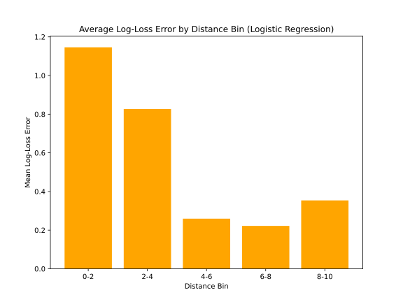

# Basketball Shot Model Evaluation

How well can simple models predict the type of a basketball shot, and how far can we trust the usual evaluation numbers? This project compares four classifiers on a dataset of basketball shots and looks at where and why they make mistakes.



## What I did

- Compared a baseline, logistic regression, kNN with k chosen on the training folds, and kNN tuned with nested cross-validation. Each model was evaluated with 5-fold CV on log-score and accuracy, with standard deviations.
- Looked at how prediction error changes with shot distance.
- Reweighted the evaluation by how often each competition actually appears (NBA 0.6, the others 0.1) to see how much that shifts the overall numbers.

## Results

- Logistic regression did best, with the lowest log-score and the highest accuracy.
- Nested CV helped kNN, but it still trailed logistic regression.
- Error is moderately negatively correlated with distance (r = -0.46). Shots close to the basket are the hardest to classify.
- Reweighting by competition frequency changes the overall metrics noticeably, so the choice of evaluation set matters.

## Files

- `model_evaluation.py`: model comparison, distance analysis and all plots
- `competition_reweighting.py`: the competition reweighting on its own
- `dataset.csv`: shot data, with the shot type as the target
- `*.svg`: the generated plots

## Running it

```bash
pip install numpy pandas scikit-learn matplotlib
python model_evaluation.py
```
